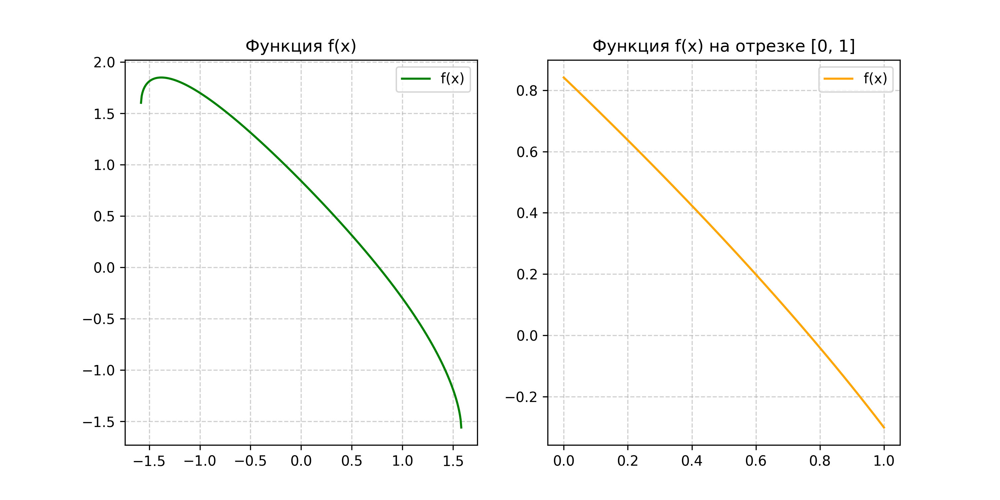
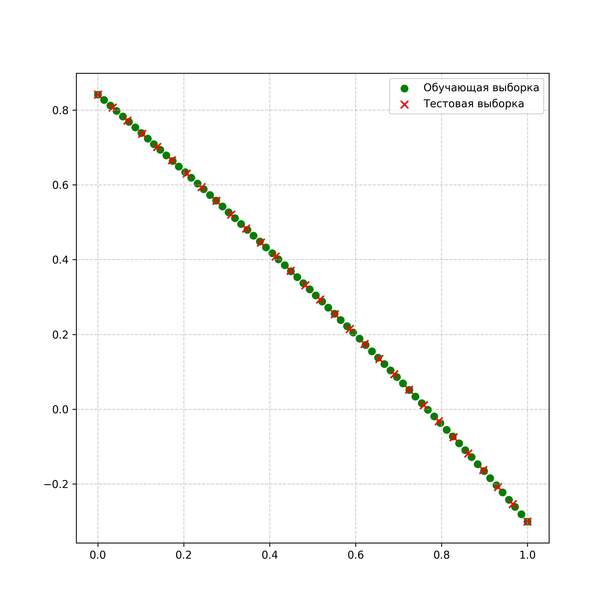
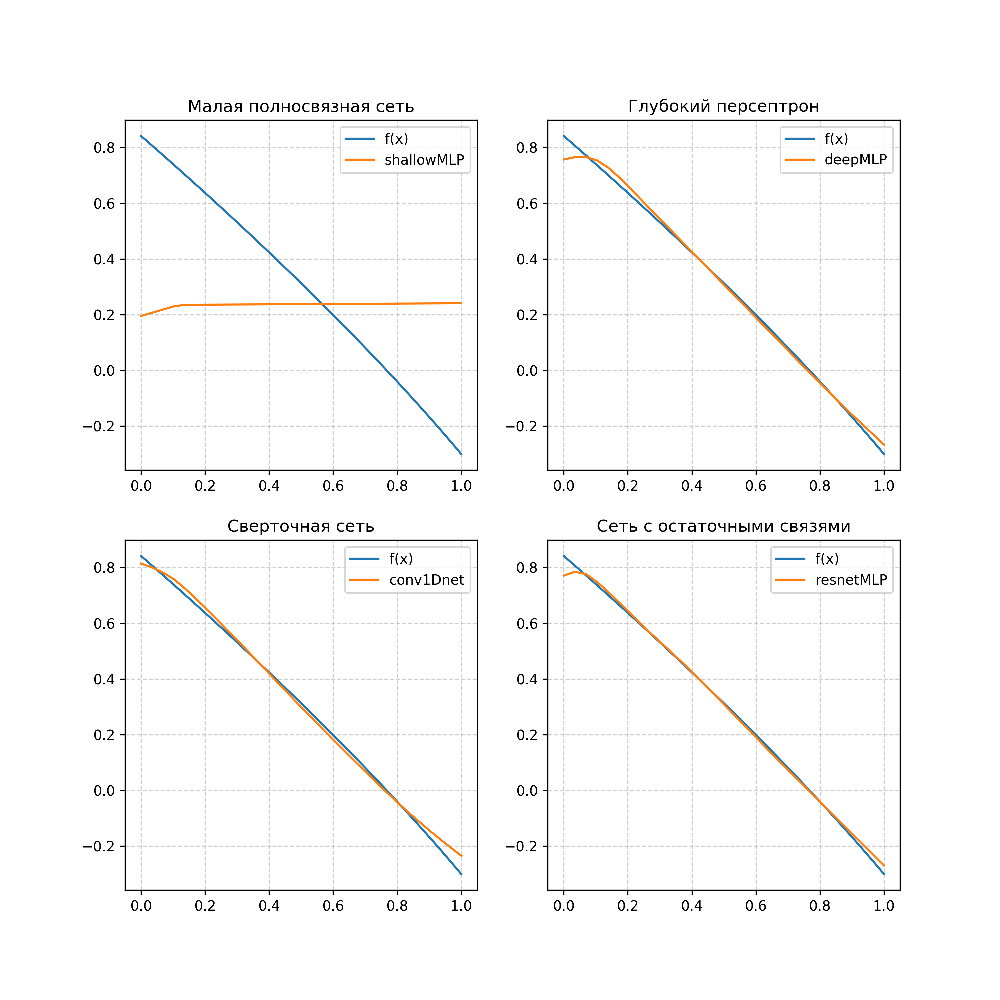
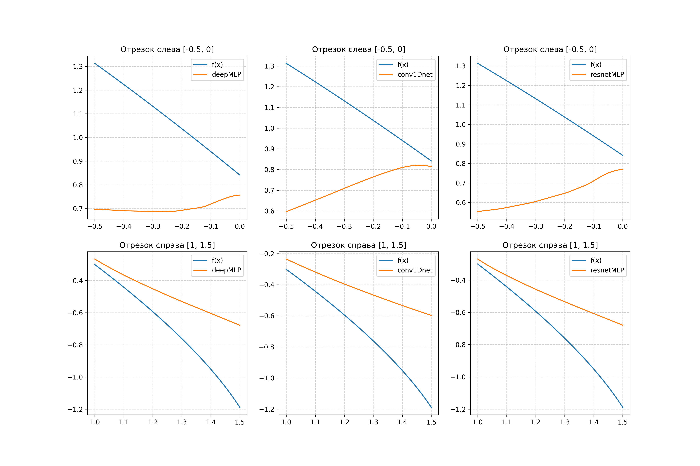
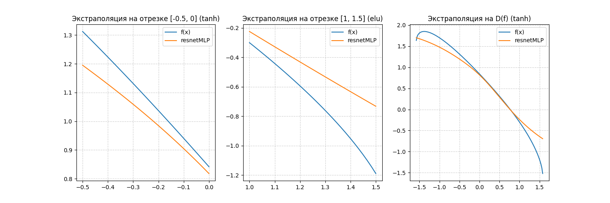

# Проектирование и разработка искусственных нейронных сетей

Учебный научно-исследовательский проект по дисциплине **«Актуальные задачи прикладной математики и информатики»** (НИУ «МЭИ», ИВТИ, кафедра ПМИИ).  
**Выполнила:** студентка гр. А-05м-26 Бурчина О. Я.  
**Преподаватель:** Варшавский П. Р.

---


## Цель работы и постановка задачи

**Цель:** исследование возможностей аппроксимации сложной нелинейной одномерной функции с использованием различных классов нейросетевых архитектур (Shallow MLP, Deep MLP, 1D-CNN, ResNet-MLP) во фреймворке TensorFlow/Keras, а также комплексный анализ влияния гиперпараметров обучения на точность интерполяции и устойчивость экстраполяции за пределы обучающего диапазона.

**Задачи:**
1. Сформировать обучающую и тестовую выборки для аппроксимации заданной нелинейной функции на отрезке $x \in [0, 1]$.
2. Спроектировать, обучить и сравнить четыре нейросетевые архитектуры различной глубины и топологии.
3. Проанализировать способность обученных моделей к экстраполяции на интервалах слева $[-0.5, 0]$, справа $[1, 1.5]$ и на всей допустимой области определения функции $D(f)$.
4. Оценить статистическую устойчивость моделей с помощью серии экспериментов со случайными начальными инициализациями (`random_seed`).
5. Провести детальное исследование влияния гиперпараметров (оптимизаторы, функции активации, число эпох, размер батча) на качество интерполяции и экстраполяции на базе лучшей архитектуры (ResNet-MLP).
6. Выявить оптимальную конфигурацию сети, способную преодолеть проблему вырождения нейросетевой экстраполяции.

---

## Математическая модель и выборки

### Целевая функция

Исследуется нелинейная функция:

$$
f(x) = \sin\left(\sqrt{1 - 0.4x^2}\right) - x
$$

- **Область определения функции $D(f)$:** подкоренное выражение должно быть неотрицательным:
  $$
  1 - 0.4x^2 \ge 0 \implies x^2 \le 2.5 \implies x \in \left[-\sqrt{2.5}, \, \sqrt{2.5}\right] \approx [-1.5811, \, 1.5811]
  $$
- **Интервал обучения (интерполяции):** $x \in [0, 1]$.



### Формирование выборок

Для обучения и тестирования на интервале $[0, 1]$ сформированы равномерные сетки значений:
- **Обучающая выборка ($N_{\text{train}} = 70$):** $x_{\text{train}} \in [0, 1]$, $y_{\text{train}} = f(x_{\text{train}})$.
- **Тестовая выборка ($N_{\text{test}} = 30$):** $x_{\text{test}} \in [0, 1]$, $y_{\text{test}} = f(x_{\text{test}})$.



Для анализа экстраполяции используются дополнительные множества:
- **Левый отрезок:** $x_{\text{left}} \in [-0.5, 0]$ (30 точек);
- **Правый отрезок:** $x_{\text{right}} \in [1.0, 1.5]$ (30 точек);
- **Полная область определения $D(f)$:** $x_{\text{full}} \in [-1.58, 1.58]$ (150 точек, удовлетворяющих условию $1 - 0.4x^2 \ge 0$).

### Метрики качества

Качество аппроксимации оценивается по трем критериям:
- **MSE** (Mean Squared Error, среднеквадратичная ошибка);
- **MAE** (Mean Absolute Error, средняя абсолютная ошибка);
- **$R^2$** (Coefficient of Determination, коэффициент детерминации):
  $$
  R^2 = 1 - \frac{\sum (y_i - \hat{y}_i)^2}{\sum (y_i - \bar{y})^2}
  $$

---

## Исследуемые архитектуры нейронных сетей

В исследовании реализованы 4 архитектуры с последовательным усложнением топологии:

| Архитектура | Описание структуры | Назначение |
| :--- | :--- | :--- |
| **`shallowMLP`** | `Input(1)` $\to$ `Dense(16, relu)` $\to$ `Dense(1)` | Базовая малая полносвязная сеть для проверки достаточности одного скрытого слоя |
| **`deepMLP`** | `Input(1)` $\to$ 3 слоя $\times$ `Dense(64, relu)` $\to$ `Dense(1)` | Глубокий многослойный перцептрон с увеличенной емкостью |
| **`conv1Dnet`** | `Input(1)` $\to$ `Dense(32, relu)` $\to$ `Reshape(32, 1)` $\to$ 2 слоя `Conv1D(32, kernel=3, padding='same', relu)` $\to$ `Flatten` $\to$ `Dense(1)` | Одномерная сверточная сеть для извлечения локальных корреляционных паттернов |
| **`resnetMLP`** | `Input(1)` $\to$ `Dense(64, relu)` $\to$ 2 остаточных блока (`Dense(64, relu)` $\to$ `Dense(64)` $+$ residual $\to$ `Activation`) $\to$ `Dense(1)` | Полносвязная сеть с residual-соединениями (skip connections), предотвращающая затухание градиентов |

Во всех базовых моделях используется оптимизатор **Adam**, функция потерь **MSE**, функция активации **ReLU**. Обучение проводится на 30 эпохах с размером батча 32.

---

## Этап 1. Сравнение архитектур на интервале обучения (интерполяция)

При фиксированном зерне генератора случайных чисел (`seed = 123`) модели были обучены на выборке $N_{\text{train}} = 70$ и протестированы на выборке $N_{\text{test}} = 30$ ($x \in [0, 1]$):

| Модель | MSE | MAE | $R^2$ |
| :--- | :---: | :---: | :---: |
| `shallowMLP` | 0.123376 | 0.302377 | -0.073717 |
| `deepMLP` | 0.000492 | 0.015031 | 0.995715 |
| `conv1Dnet` | 0.000456 | 0.016501 | 0.996030 |
| **`resnetMLP`** | **0.000278** | **0.009973** | **0.997578** |

### Анализ результатов интерполяции
1. Однослойная сеть `shallowMLP` (16 нейронов) не справилась с аппроксимацией нелинейной кривизны ($R^2 < 0$), продемонстрировав выраженное недообучение из-за недостатка параметров.
2. Глубокие архитектуры `deepMLP`, `conv1Dnet` и `resnetMLP` показали превосходное качество интерполяции ($R^2 > 0.995$).
3. Наименьшую ошибку и максимальный коэффициент детерминации продемонстрировала сеть с остаточными связями **`resnetMLP`** ($R^2 = 0.99758$, $\text{MSE} = 2.78 \times 10^{-4}$).



---

## Этап 2. Исследование способности к экстраполяции

### Экстраполяция на локальных отрезках слева и справа

Модели, обученные на $[0, 1]$, были протестированы на соседних отрезках $[-0.5, 0]$ (слева) и $[1.0, 1.5]$ (справа):

| Модель | MSE (слева) | MAE (слева) | $R^2$ (слева) | MSE (справа) | MAE (справа) | $R^2$ (справа) |
| :--- | :---: | :---: | :---: | :---: | :---: | :---: |
| `deepMLP` | 0.167706 | 0.377831 | -7.465470 | 0.065158 | 0.212948 | 0.032079 |
| `conv1Dnet` | 0.170495 | 0.353417 | -7.606218 | 0.097662 | 0.272340 | -0.450767 |
| **`resnetMLP`** | 0.237757 | 0.440574 | -11.001476 | **0.063710** | **0.208693** | **0.053590** |



**Вывод:** стандартная активация ReLU за пределами диапазона обучения вырождается в линейные асимптоты, поэтому все базовые модели испытывают резкую деградацию качества при экстраполяции (особенно слева, где кривизна функции меняет знак).

---

### Экстраполяция на всей области определения функции с оценкой устойчивости (10 seed)

Для исключения фактора случайной удачной инициализации весов был проведен эксперимент с 10 независимыми запусками (`seed` $\in \{10, 20, 30, 40, 50, 60, 70, 80, 90, 100\}$) на всей области определения $D(f) \approx [-1.58, 1.58]$:

#### Результаты по отдельным запускам (MSE / MAE / $R^2$):

| Random Seed | `conv1Dnet` ($R^2$) | `deepMLP` ($R^2$) | `resnetMLP` ($R^2$) |
| :---: | :---: | :---: | :---: |
| 10 | 0.3919 | 0.3600 | 0.2704 |
| 20 | -0.1672 | 0.1377 | 0.6256 |
| 30 | -0.0938 | 0.2015 | 0.6922 |
| 40 | 0.3503 | 0.2320 | 0.2329 |
| 50 | 0.1477 | 0.6191 | 0.6532 |
| 60 | 0.2249 | 0.6693 | 0.8045 |
| 70 | 0.2291 | 0.3255 | 0.6554 |
| 80 | 0.3488 | 0.5614 | 0.4772 |
| 90 | 0.0573 | 0.2282 | 0.7286 |
| 100 | 0.1579 | 0.1688 | 0.5982 |

#### Усредненные метрики по 10 запускам:

| Архитектура | Средний MSE | Средний MAE | Средний $R^2$ |
| :--- | :---: | :---: | :---: |
| `conv1Dnet` | 0.73022 | 0.58792 | 0.16469 |
| `deepMLP` | 0.56791 | 0.53530 | 0.35035 |
| **`resnetMLP`** | **0.37256** | **0.42567** | **0.57382** |

.png)

> **Ключевой вывод этапа:**  
> Архитектура **`resnetMLP`** продемонстрировала наилучшую обобщающую способность и стабильность (средний $R^2 = 0.574$ против $0.350$ у DeepMLP и $0.165$ у Conv1Dnet). Поэтому именно архитектура `resnetMLP` была выбрана в качестве базовой платформы для последующего исследования гиперпараметров.

---

## Этап 3. Исследование влияния гиперпараметров на обучение (ResNet-MLP)

Исследование влияния параметров выполнено на базе архитектуры **`resnetMLP`**. При варьировании одного параметра остальные фиксировались на базовых значениях: `optimizer='adam'`, `activation='relu'`, `epochs=30`, `batch_size=32`.

Оценка производилась одновременно на четырех тестовых диапазонах:
1. Интерполяция: $[0, 1]$
2. Экстраполяция слева: $[-0.5, 0]$
3. Экстраполяция справа: $[1, 1.5]$
4. Экстраполяция на всей области определения: $D(f)$

---

### 1. На отрезке интерполяции [0, 1]

<details>
<summary><b>Развернуть таблицы результатов для интерполяции [0, 1]</b></summary>

#### Оптимизаторы
| Оптимизатор | Время обучения (с) | MSE | MAE | $R^2$ |
| :--- | :---: | :---: | :---: | :---: |
| SGD | 0.3131 | 0.016285 | 0.105333 | 0.85827 |
| RMSprop | 0.5238 | 0.002573 | 0.037083 | 0.97761 |
| **Adam** | **0.7031** | **0.000278** | **0.009973** | **0.99758** |

#### Функции активации
| Активация | Время обучения (с) | MSE | MAE | $R^2$ |
| :--- | :---: | :---: | :---: | :---: |
| ReLU | 0.7162 | 0.000278 | 0.009973 | 0.99758 |
| Tanh | 0.7823 | 0.000161 | 0.010564 | 0.99860 |
| Sigmoid | 0.7145 | 0.115329 | 0.292164 | -0.00369 |
| **ELU** | **0.7726** | **0.000087** | **0.008005** | **0.99924** |

#### Количество эпох
| Эпохи | Время обучения (с) | MSE | MAE | $R^2$ |
| :---: | :---: | :---: | :---: | :---: |
| 2 | 0.5064 | 0.164342 | 0.348708 | -0.43025 |
| 4 | 0.5196 | 0.140210 | 0.321497 | -0.22023 |
| 8 | 0.5519 | 0.045628 | 0.178045 | 0.60291 |
| 16 | 0.6077 | 0.002889 | 0.043264 | 0.97485 |
| **32** | **0.7281** | **0.000212** | **0.009241** | **0.99815** |

#### Размер батча
| Batch size | Время обучения (с) | MSE | MAE | $R^2$ |
| :---: | :---: | :---: | :---: | :---: |
| 8 | 0.7503 | 0.000301 | 0.015139 | 0.99738 |
| **16** | **0.7128** | **0.000086** | **0.006366** | **0.99925** |
| 32 | 0.7153 | 0.000278 | 0.009973 | 0.99758 |
| 64 | 0.6931 | 0.001450 | 0.022393 | 0.98738 |
| 70 | 0.6356 | 0.004041 | 0.036006 | 0.96483 |

</details>

**Выводы по интерполяции:**
- `Adam` существенно опережает `RMSprop` и `SGD`.
- `ELU`, `Tanh` и `ReLU` показывают превосходную аппроксимацию ($R^2 > 0.997$), в то время как `Sigmoid` приводит к затуханию градиентов ($R^2 < 0$).
- Батчи 16–32 обеспечивают оптимальный баланс стохастического шума и скорости сходимости.

---

### 2. На левом отрезке экстраполяции [-0.5, 0]

<details>
<summary><b>Развернуть таблицы результатов для левого отрезка [-0.5, 0]</b></summary>

#### Оптимизаторы
| Оптимизатор | Время (с) | MSE | MAE | $R^2$ |
| :--- | :---: | :---: | :---: | :---: |
| SGD | 0.3102 | 0.534160 | 0.693485 | -25.96327 |
| RMSprop | 0.5208 | 0.307126 | 0.508980 | -14.50308 |
| **Adam** | **0.7093** | **0.237757** | **0.440574** | **-11.00148** |

#### Функции активации
| Активация | Время (с) | MSE | MAE | $R^2$ |
| :--- | :---: | :---: | :---: | :---: |
| ReLU | 0.7048 | 0.237757 | 0.440574 | -11.00148 |
| **Tanh** | **0.7135** | **0.002064** | **0.036597** | **+0.89582** |
| Sigmoid | 0.7086 | 0.580846 | 0.749110 | -28.31990 |
| ELU | 0.7048 | 0.036037 | 0.155291 | -0.81905 |

#### Количество эпох
| Эпохи | Время (с) | MSE | MAE | $R^2$ |
| :---: | :---: | :---: | :---: | :---: |
| 2 | 0.4988 | 1.120503 | 1.045162 | -55.56063 |
| 4 | 0.5140 | 0.962586 | 0.966803 | -47.58931 |
| 8 | 0.5495 | 0.676449 | 0.802501 | -33.14571 |
| **16** | **0.5968** | **0.228344** | **0.431443** | **-10.52631** |
| 32 | 0.7180 | 0.232027 | 0.433712 | -10.71226 |

#### Размер батча
| Batch size | Время (с) | MSE | MAE | $R^2$ |
| :---: | :---: | :---: | :---: | :---: |
| 8 | 0.7593 | 0.246859 | 0.443952 | -11.46090 |
| **16** | **0.7365** | **0.230292** | **0.427005** | **-10.62467** |
| 32 | 0.7079 | 0.237757 | 0.440574 | -11.00148 |
| 64 | 0.6901 | 0.271367 | 0.481251 | -12.69801 |
| 70 | 0.6377 | 0.383033 | 0.589142 | -18.33469 |

</details>

> **Важнейшее открытие:**  
> Переход от кусочно-линейной функции `ReLU` к гладкой нелинейности **`Tanh`** дал колоссальный прорыв в экстраполяции влево: **$R^2$ вырос с $-11.00$ до $+0.89582$**, а среднеквадратичная ошибка **MSE снизилась в 115 раз** (с $0.237757$ до $0.002064$).

---

### 3. На правом отрезке экстраполяции [1, 1.5]

<details>
<summary><b>Развернуть таблицы результатов для правого отрезка [1, 1.5]</b></summary>

#### Оптимизаторы
| Оптимизатор | Время (с) | MSE | MAE | $R^2$ |
| :--- | :---: | :---: | :---: | :---: |
| SGD | 0.3116 | 0.257125 | 0.477579 | -2.81957 |
| RMSprop | 0.5189 | 0.196493 | 0.404516 | -1.91889 |
| **Adam** | **0.7201** | **0.063710** | **0.208693** | **0.05359** |

#### Функции активации
| Активация | Время (с) | MSE | MAE | $R^2$ |
| :--- | :---: | :---: | :---: | :---: |
| ReLU | 0.6994 | 0.063710 | 0.208693 | 0.05359 |
| Tanh | 0.7029 | 0.057947 | 0.202453 | 0.13920 |
| Sigmoid | 0.7038 | 1.120204 | 1.026215 | -15.64054 |
| **ELU** | **0.7191** | **0.027839** | **0.137780** | **+0.58645** |

#### Количество эпох
| Эпохи | Время (с) | MSE | MAE | $R^2$ |
| :---: | :---: | :---: | :---: | :---: |
| 2 | 0.5045 | 1.193751 | 1.054225 | -16.73309 |
| 4 | 0.5139 | 1.219446 | 1.068690 | -17.11478 |
| 8 | 0.5434 | 0.466896 | 0.647840 | -5.93571 |
| 16 | 0.6030 | 0.072284 | 0.223812 | -0.07377 |
| **32** | **0.7179** | **0.060676** | **0.201644** | **+0.09867** |

#### Размер батча
| Batch size | Время (с) | MSE | MAE | $R^2$ |
| :---: | :---: | :---: | :---: | :---: |
| 8 | 0.7624 | 0.055415 | 0.190290 | 0.17682 |
| **16** | **0.7685** | **0.043159** | **0.165896** | **+0.35887** |
| 32 | 0.7045 | 0.063710 | 0.208693 | 0.05359 |
| 64 | 0.6923 | 0.117374 | 0.303876 | -0.74358 |
| 70 | 0.6354 | 0.101211 | 0.272342 | -0.50349 |

</details>

**Вывод:** на правом интервале лучшую способность к сохранению характера поведения функции продемонстрировала функция активации **`ELU`** ($R^2 = 0.58645$, MSE $= 0.027839$).

---

### 4. На всей области определения функции D(f)

<details>
<summary><b>Развернуть таблицы результатов для всей области определения D(f)</b></summary>

#### Оптимизаторы
| Оптимизатор | Время (с) | MSE | MAE | $R^2$ |
| :--- | :---: | :---: | :---: | :---: |
| SGD | 0.3065 | 1.096876 | 0.802681 | -0.25477 |
| RMSprop | 0.5131 | 0.698720 | 0.625676 | 0.20070 |
| **Adam** | **0.7148** | **0.548497** | **0.526933** | **0.37255** |

#### Функции активации
| Активация | Время (с) | MSE | MAE | $R^2$ |
| :--- | :---: | :---: | :---: | :---: |
| ReLU | 0.7066 | 0.548497 | 0.526933 | 0.37255 |
| **Tanh** | **0.7023** | **0.026495** | **0.102855** | **+0.96969** |
| Sigmoid | 0.6935 | 0.995557 | 0.871154 | -0.13887 |
| ELU | 0.7209 | 0.250072 | 0.333995 | 0.71393 |

#### Количество эпох
| Эпохи | Время (с) | MSE | MAE | $R^2$ |
| :---: | :---: | :---: | :---: | :---: |
| 2 | 0.5057 | 1.579390 | 1.089892 | -0.80674 |
| 4 | 0.5129 | 1.436107 | 1.038169 | -0.64283 |
| 8 | 0.5458 | 1.048085 | 0.839216 | -0.19895 |
| **16** | **0.6133** | **0.524954** | **0.529202** | **0.39948** |
| 32 | 0.7204 | 0.541869 | 0.522231 | 0.38013 |

#### Размер батча
| Batch size | Время (с) | MSE | MAE | $R^2$ |
| :---: | :---: | :---: | :---: | :---: |
| 8 | 0.7711 | 0.597863 | 0.545386 | 0.31608 |
| 16 | 0.7401 | 0.549906 | 0.518137 | 0.37094 |
| **32** | **0.7137** | **0.548497** | **0.526933** | **0.37255** |
| 64 | 0.6965 | 0.578566 | 0.560369 | 0.33815 |
| 70 | 0.6502 | 0.700188 | 0.617378 | 0.19902 |

</details>

**Вывод:**  
На всей области $D(f)$ функция **`Tanh`** показала рекордное качество: **$R^2 = 0.96969$**, **$\text{MSE} = 0.026495$** (снижение ошибки более чем в 20 раз по сравнению с ReLU). Оптимальным числом эпох оказалось 16, а батчем — 16–32.

---

## Этап 4. Валидация оптимизированной модели (ResNet-MLP)

Для строгой статистической проверки лучшей конфигурации (`resnetMLP` с функцией активации `tanh`, обученной в течение 16 эпох с батчем 32 и оптимизатором Adam) был проведен повторный цикл из 10 экспериментов с различными `random_seed`:

| Seed | MSE | MAE | $R^2$ |
| :---: | :---: | :---: | :---: |
| 10 | 0.0156 | 0.0671 | 0.9821 |
| 20 | 0.0273 | 0.0936 | 0.9688 |
| 30 | 0.0231 | 0.0992 | 0.9736 |
| 40 | 0.0343 | 0.1324 | 0.9607 |
| 50 | 0.0263 | 0.0846 | 0.9700 |
| 60 | 0.0296 | 0.0970 | 0.9662 |
| 70 | 0.0335 | 0.1333 | 0.9616 |
| 80 | 0.0365 | 0.1351 | 0.9583 |
| 90 | 0.0298 | 0.0845 | 0.9659 |
| 100 | 0.0236 | 0.0822 | 0.9730 |
| **Среднее** | **0.02796** | **0.10090** | **0.96802** |

### Сравнение базовой и оптимизированной моделей:
- **Базовая модель (ResNet-MLP + ReLU, 30 эпох):** средний $R^2 = 0.57382$, средний $\text{MSE} = 0.37256$;
- **Оптимизированная модель (ResNet-MLP + Tanh, 16 эпох):** средний $R^2 = 0.96802$, средний $\text{MSE} = 0.02796$.

> Средняя квадратичная ошибка экстраполяции снизилась более чем в **13.3 раза**, а коэффициент детерминации возрос до $0.968$ на всей области $D(f)$.

### Графики экстраполяции оптимизированных моделей



*На графике представлены: экстраполяция слева с функцией `tanh` ($R^2 \approx 0.90$), экстраполяция справа с функцией `elu` ($R^2 \approx 0.59$) и глобальная экстраполяция на всей области определения $D(f)$ с функцией `tanh` ($R^2 \approx 0.97$).*

---

## Итоговые выводы и рекомендации

1. **Емкость и архитектура сети:**
   - Однослойная сеть `shallowMLP` не обладает достаточной выразительностью для гладкой нелинейной аппроксимации ($R^2 = -0.07$).
   - Архитектура с остаточными связями **`resnetMLP`** превосходит традиционные многослойные перцептроны и сверточные сети как по качеству интерполяции ($R^2 = 0.99758$), так и по обобщающей способности при экстраполяции ($R^2 = 0.574$ в базовой конфигурации против $0.165$ у Conv1D).
2. **Ключевая роль функции активации при экстраполяции:**
   - Кусочно-линейная функция `ReLU` не пригодна для экстраполяции гладких нелинейностей: за пределами обучающей сетки она формирует прямолинейные лучи.
   - Замена активации на гладкую сигмоидальную функцию **`Tanh`** позволяет сохранить кривизну функции за пределами области обучения, повышая $R^2$ с $-11.00$ до $+0.90$ слева и обеспечивая средний $R^2 = 0.968$ на всей $D(f)$.
   - Для асимметричной экстраполяции вправо наилучший результат показывает функция **`ELU`** ($R^2 = 0.586$).
3. **Оптимизатор:**
   - Алгоритм **Adam** показал подавляющее преимущество над SGD и RMSprop благодаря адаптивной оценке моментов первого и второго порядков.
4. **Регуляризация числом эпох и размером батча:**
   - Увеличение числа эпох свыше 16 ведет к переобучению на интервале $[0, 1]$ и ухудшает качество экстраполяции.
   - Оптимальный размер мини-батча — 16–32. Использование полновыборочного градиентного спуска (батч 64–70) ухудшает обобщение из-за потери полезного стохастического шума.

---

## Структура проекта

```text
.
├── NN.ipynb                               # Основной Jupyter Notebook с исследованиями и кодом
├── requirements.txt                       # Зависимости проекта
├── README.md                              # Документация и детальный отчет по исследованию
├── ЛР№4-5 Бурчина Ольга А-05м-26.docx      # Официальный отчет по лабораторной работе
│
├── func.png                               # График целевой функции f(x)
├── samples.png                            # График обучающей (N=70) и тестовой (N=30) выборок
├── interpolation.png                      # Сравнение интерполяции 4-х архитектур на [0, 1]
├── left_right.png                         # Экстраполяция базовых архитектур на отрезках [-0.5, 0] и [1, 1.5]
├── full_D(f).png                          # Экстраполяция базовых архитектур на всей области определения D(f)
└── extrapolation.png                      # Экстраполяция оптимизированной ResNet-MLP (tanh, elu)
```

---

## Инструкция по запуску

### Предварительные требования
- Python версии 3.9 или выше;
- Установленный менеджер пакетов `pip`.

### Установка и запуск

1. Клонируйте репозиторий или перейдите в рабочую папку проекта:
   ```bash
   cd <путь_к_папке_проекта>
   ```

2. Создайте и активируйте виртуальное окружение:
   ```bash
   python -m venv .venv
   source .venv/bin/activate       # macOS / Linux
   # .venv\Scripts\activate        # Windows
   ```

3. Установите зависимости:
   ```bash
   pip install -r requirements.txt
   ```

4. Запустите Jupyter Notebook:
   ```bash
   jupyter notebook NN.ipynb
   ```

5. Выполните ячейки ноутбука последовательно (`Kernel -> Restart & Run All`). Все графики будут сохранены в формате PNG высокого разрешения (300 DPI).

---

## Стек технологий

- **Язык программирования:** Python 3.x
- **Глубокое обучение:** TensorFlow / Keras (Sequential API, Functional API, ResNet blocks, Conv1D)
- **Научные вычисления:** NumPy, SciPy
- **Метрики и валидация:** scikit-learn (MSE, MAE, $R^2$)
- **Анализ данных:** pandas
- **Визуализация:** Matplotlib
