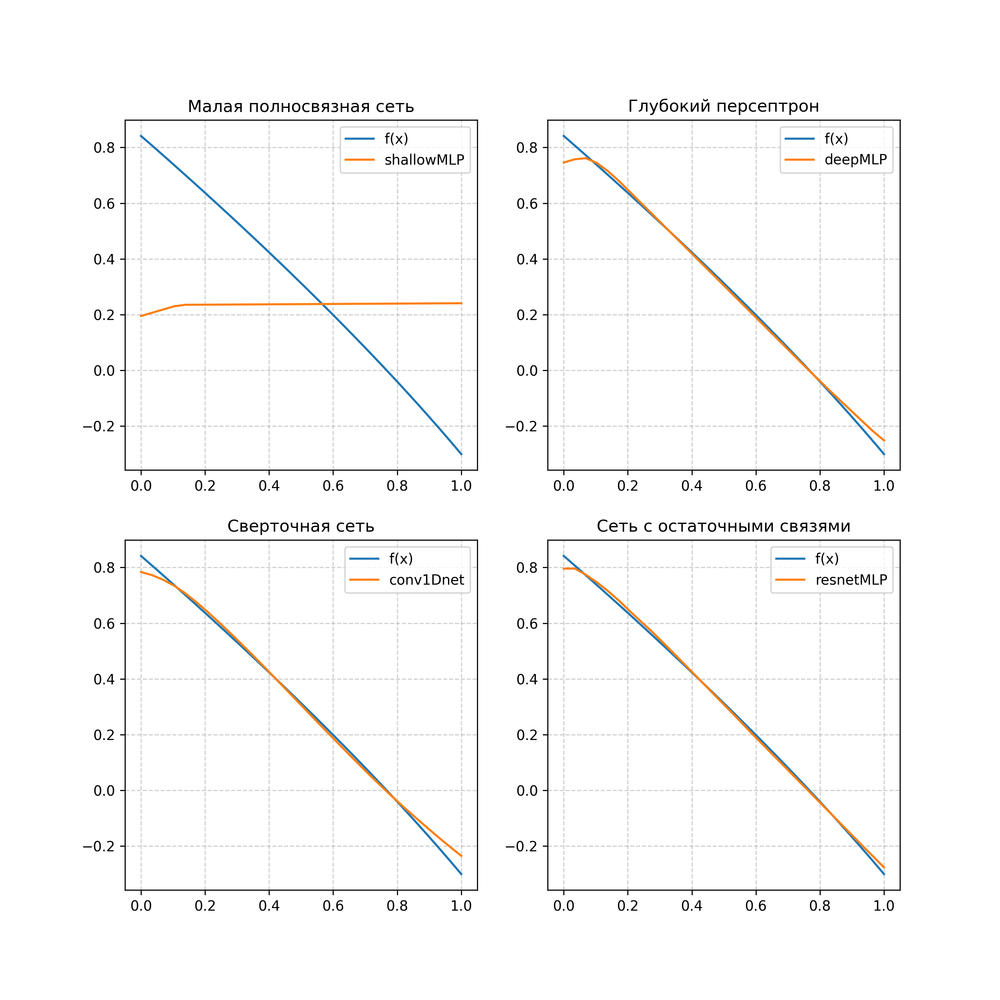
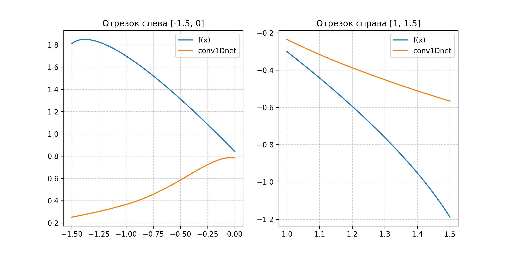

# Проектирование и разработка искусственных нейронных сетей

Учебный проект по дисциплине «Актуальные задачи прикладной математики и информатики».

В проекте реализованы проектирование и сравнение нескольких нейросетевых архитектур для аппроксимации одномерной функции, а также исследование влияния параметров обучения на качество модели.

## Задача

Необходимо приблизить функцию

$$
f(x) = \sin\left(\sqrt{1 - 0.4x^2}\right) - x
$$

на отрезке $x \in [0, 1]$, сравнить архитектуры нейронных сетей и оценить поведение обученной свёрточной сети за пределами обучающего диапазона.

## Реализованные модели

| Модель | Архитектура |
| --- | --- |
| `shallowMLP` | Полносвязная сеть: один скрытый слой из 16 нейронов |
| `deepMLP` | Глубокая полносвязная сеть: три слоя по 64 нейрона |
| `conv1Dnet` | Одномерная свёрточная сеть с двумя слоями `Conv1D` |
| `resnetMLP` | Полносвязная сеть с остаточными связями |

В качестве функции потерь используется MSE. Качество оценивается метриками MSE, MAE и $R^2$.

## Результаты

При фиксированном случайном зерне (`seed = 123`) модели показали следующие результаты на тестовой выборке:

| Модель | MSE | MAE | $R^2$ |
| --- | ---: | ---: | ---: |
| `shallowMLP` | 0.123376 | 0.302377 | -0.073717 |
| `deepMLP` | 0.000592 | 0.014748 | 0.994851 |
| `conv1Dnet` | 0.000517 | 0.015614 | 0.995505 |
| `resnetMLP` | 0.000164 | 0.009634 | 0.998570 |

Лучший результат в данном запуске получен у `resnetMLP`. Для воспроизводимости в ноутбуке фиксируются генераторы случайных чисел Python, NumPy и TensorFlow.

### Аппроксимация



### Экстраполяция Conv1D

Модель `conv1Dnet`, обученная на $[0, 1]$, дополнительно проверяется на интервалах $[-1.5, 0]$ и $[1, 1.5]$. Эксперимент показывает, что высокая точность интерполяции внутри обучающего диапазона не гарантирует хорошую экстраполяцию.



## Исследование параметров обучения

Исследование выполнено для `deepMLP` с тремя скрытыми слоями по 64 нейрона. Если параметр не изменяется, используются базовые настройки: оптимизатор Adam, функция активации ReLU, 30 эпох и `batch_size = 32`.

### Оптимизатор

| Оптимизатор | MSE | MAE | $R^2$ |
| --- | ---: | ---: | ---: |
| SGD | 0.079848 | 0.243076 | 0.30510 |
| RMSprop | 0.002174 | 0.043825 | 0.98108 |
| Adam | 0.000492 | 0.015031 | 0.99571 |

Adam показал наилучшее качество среди рассмотренных оптимизаторов.

### Функция активации

| Активация | MSE | MAE | $R^2$ |
| --- | ---: | ---: | ---: |
| ReLU | 0.000492 | 0.015031 | 0.99571 |
| Tanh | 0.000292 | 0.013515 | 0.99746 |
| Sigmoid | 0.114208 | 0.290667 | 0.00607 |
| ELU | 0.000369 | 0.015754 | 0.99679 |

В этом эксперименте лучшей оказалась `tanh`, тогда как `sigmoid` существенно уступила остальным функциям активации.

### Количество эпох

| Эпохи | MSE | MAE | $R^2$ |
| ---: | ---: | ---: | ---: |
| 10 | 0.101386 | 0.272002 | 0.11765 |
| 30 | 0.000492 | 0.015031 | 0.99571 |
| 100 | 0.000109 | 0.008534 | 0.99905 |
| 300 | 0.000010 | 0.002347 | 0.99991 |

Увеличение числа эпох в заданном диапазоне улучшает аппроксимацию, но увеличивает время обучения.

### Размер batch

| Batch size | MSE | MAE | $R^2$ |
| ---: | ---: | ---: | ---: |
| 8 | 0.000703 | 0.023369 | 0.99389 |
| 16 | 0.000200 | 0.010951 | 0.99826 |
| 32 | 0.000492 | 0.015031 | 0.99571 |
| 64 | 0.005899 | 0.058432 | 0.94866 |
| 70 | 0.063041 | 0.207565 | 0.45136 |

Наилучшее качество среди проверенных значений обеспечил `batch_size = 16`; слишком крупные батчи снизили точность.

## Структура проекта

```text
.
├── NN.ipynb          # основной Jupyter-ноутбук с экспериментами
├── func.png          # исходная функция
├── samples.png       # обучающая и тестовая выборки
├── graf.png          # сравнение предсказаний моделей
├── left_right.png    # эксперимент с экстраполяцией Conv1D
├── requirements.txt  # зависимости Python
└── README.md
```

## Запуск

Требуется Python 3.9 или новее.

```bash
git clone <URL-вашего-репозитория>
cd <имя-папки-репозитория>
python -m venv .venv
source .venv/bin/activate  # Windows: .venv\\Scripts\\activate
pip install -r requirements.txt
jupyter notebook NN.ipynb
```

После открытия ноутбука выполните ячейки последовательно. Графики будут сохранены в корневую папку проекта.

## План развития

- [x] Реализовать и сравнить несколько архитектур нейронных сетей.
- [x] Оценить интерполяцию и экстраполяцию модели.
- [x] Исследовать влияние оптимизатора, функции активации, числа эпох и размера batch на обучение.
- [x] Добавить воспроизводимость экспериментов через фиксирование случайного зерна.
- [x] Систематизировать результаты в таблицах.
- [ ] Исследовать влияние скорости обучения и архитектурных параметров.

## Стек

Python, Jupyter Notebook, TensorFlow/Keras, NumPy, pandas, Matplotlib, scikit-learn.
